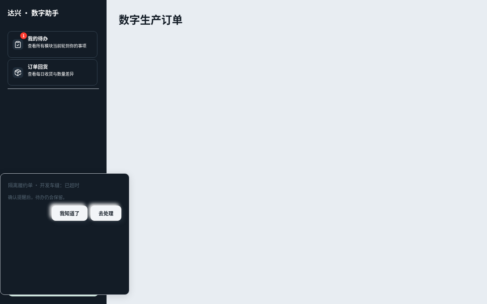
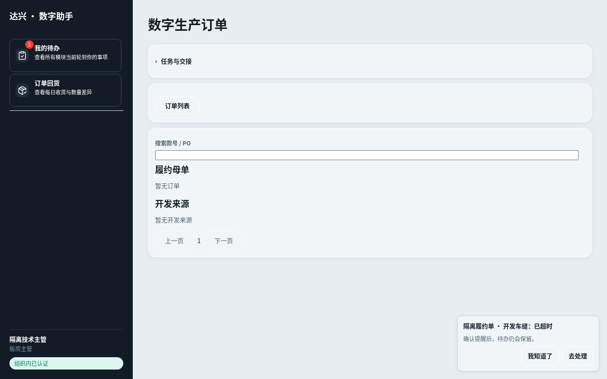
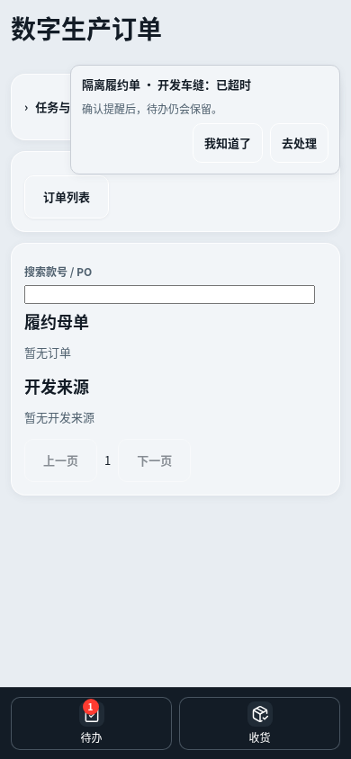
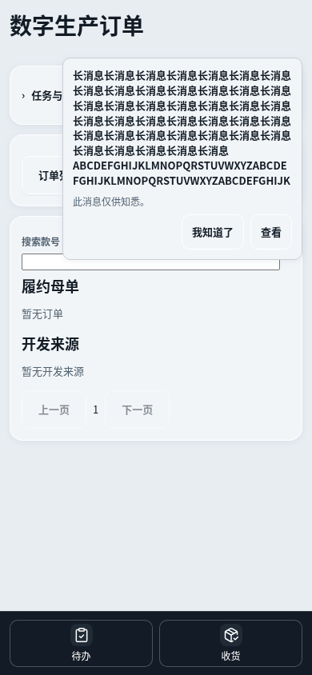

# A3 通知紧凑定位（2026-10-03）

## 预检与证据边界

- repository: lizhonghao31-crypto/dx-rework
- base: release/digital-production-v1 @ 209b00854c217c9fd2e5a6bbc0f5096c0016df0a
- branch: fix/digital-notification-layout；Gate: FULL；draft，不合并、不部署。
- scope: DigitalNotificationToast 容器及自身 CSS、离线浏览器回归、截图与本记录。
- forbidden: 通知业务逻辑/文案、API/数据/权限、整个侧栏样式及部署。

用户要求通知“小小的一个，贴着右下角”。用户原 Library 图片未取得可读像素，
官方本地 materialization 被代理以 403 拒绝；不声称看过原图。用户后续明确允许
依据已查看的本地实际复现及布局要求施工，无需再下载或请休息用户重传。
本页所有图片均为合成通知与隔离接口的本地浏览器截图，非用户原图或线上复测。

## 根因与范围

DigitalNotificationToast 在共享 Shell 下用 aside，命中 `.app-shell > aside`
侧栏规则。本地 1280×800 计算为 sticky、左下 (0,456)、340×320、深色背景；
390px 视口则被侧栏响应式规则隐藏（display:none）。

组件是数字生产 release 的共享实现，无 Acceptance/生产环境分支。当前远端
main@99db5239 不含该组件；只能确认同一 release 部署后共用，不能断言现有生产
已出现相同通知。

通知容器改为带原名称的 section region，保留 aria-live=polite，隔离侧栏规则。
自身样式使用既有颜色/阴影变量：桌面宽300、右/下16、内边距12；手机沿用顶部
提醒位置，宽度不超视口，44px按钮，保留输入聚焦隐藏及安全区，避开底部导航。
长文区域可滚动，操作按钮不被长文挤出。确认、失败重试、已读与跳转逻辑一字未改。

| 本地截图 | 修复前 | 修复后 |
| --- | --- | --- |
| 桌面1280×800 | 左下340×320 | 右下300×118，右/下16 |
| 手机390×844 | display:none | 顶部72、宽300、高122，底部导航可用 |
| 长文 | 未作为旧版通过项 | 限高30dvh，正文滚动，完整按钮仍可见 |






## 验证

Node22.22.2/npm10.9.9；定向ESLint、web typecheck/build、通知runtime两项单测通过。
真实App/共享Shell/原通知组件的离线Chromium回归覆盖1440×1024、1280×800、
768×1024、390×844、360×800、320×568，验证计算位置、尺寸、无横向溢出、侧栏
不受影响、手机底部导航不重叠、按钮至少44px。另覆盖长文、输入聚焦、polite region、
重复刷新不重复领取、单条展示及多条依次领取、外部已读消失、确认失败留消息、
确认中禁用、键盘确认关闭、去处理保留todo和development参数。

```bash
npm run dev --workspace @dx-rework/web -- --host 127.0.0.1
# 环境需提供Playwright；CHROMIUM_PATH可指定现有Chromium。
node scripts/acceptance/digital-notification-layout-regression.mjs
```

脚本仅允许本机前端，所有API均拦截；只模拟通知领取/确认，拒绝其他写请求。
不访问线上数据库或真实业务数据。Full Gate以对应PR当前Head为准。
与#619导航、#620预派回显无代码文件重叠/顺序依赖。用户未来部署后仍须线上复测，
本地视觉证据不替代Acceptance业务验收。
