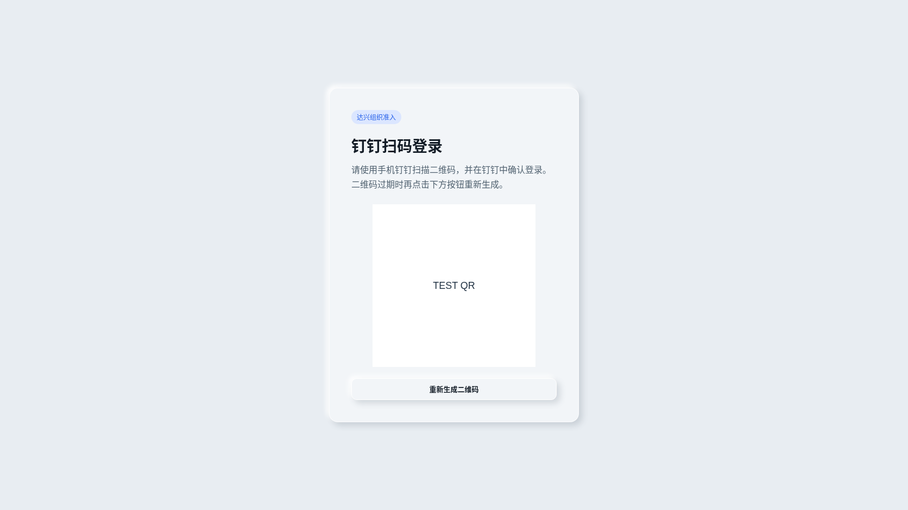
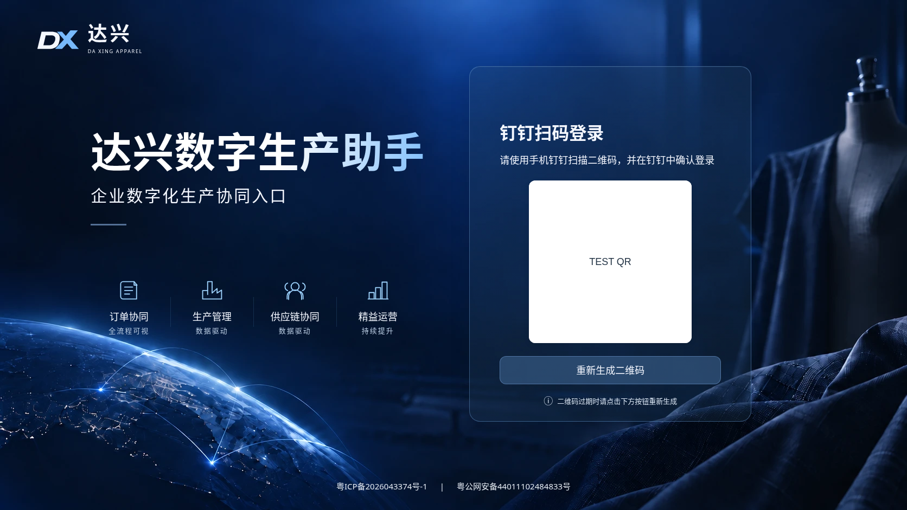

# PC 钉钉登录首页施工与核验

用户于 2026-10-09 明确授权按本窗口已读文档及两张原图施工，测试通过后合入 `release/digital-production-v1`，不部署。基线为 `bc767443bcd92463c67371a36a42af32252b1a8b`；当前 main 为 `2d4cf6ba183a0f1ce5ac04e5ddfeb60a617479b8`。本次不混合两条迁移历史。

需求依据为 Library 中《达兴数字生产助手_登录首页定稿施工计划_20261009.md》（`libfile_11f4a3c7cf308191944f3e8f4b4cde29`，400 行）及用户在对话中给出的深蓝定稿图和浅灰原登录截图。用户上传的《首页施工文档.docx》本轮无法直接取回，不能把定稿 Markdown 的读取表述为已重新读取 Word。原图 Library 下载 helper 和 materialize transfer 均失败，未获得原始文件字节，因此不宣称已验证其 SHA256。视觉参照来自已查看的对话原图；深蓝背景经图像编辑工具去掉前景 UI，再压缩成 79,604 字节 WebP。

## 实现行为

- PC `/auth/login`、`/auth/qr` 使用同一局部登录页面，品牌、标题、四项说明、按钮和备案文字为真实 DOM；二维码由原 `DTFrameLogin` SDK 生成，容器仍为 `dx-rework-dingtalk-qr`，300×300。
- 使用原 `verifySession` 做一次进入检查。未登录首次自动生成一次；过期后手动重新生成，不新增轮询或定时刷新。已有有效会话通过原 `/` 分流进入原角色工作台，无角色仍显示原提示。
- 钉钉内两条登录路径继续走原免登入口。认证 API、state/origin 校验、cookie、角色权限、`AuthGate`、业务首页、旧业务页面、Nginx/CSP、数据库及依赖均未修改。
- SDK 加载失败时清掉失败 script，使原手动重试真正重新加载；其版本、URL、参数及完成登录链路沿用原代码。
- 样式均限定于 `.dx-login-*`。不覆盖 `.auth-shell`、`.auth-card` 或业务全局 CSS。

## 证据

截图二维码区域为显式 `TEST QR` SDK 夹具，不能作为真实钉钉扫码成功证据。

| 原登录页 | 1672×941 定稿实现 |
| --- | --- |
|  |  |

[1366×768](login-homepage-20261009/desktop-1366.png) · [390px 普通浏览器](login-homepage-20261009/browser-390.png)

本地 lint、全部 workspace 类型检查和构建通过。原认证/钉钉与新页面定向测试共 51 项通过。无运行数据库的全量测试首轮 2127 项通过、512 项跳过，10 项失败均来自沙箱拒绝 fixture 子进程启动（`spawnSync ... EPERM`）；该 9 个文件在允许子进程的本地测试环境复测，42 项全部通过。未修改测试或门禁来消除失败。

浏览器 runner `tests/acceptance/login-homepage-browser.mjs` 共 21 个检查通过、页面异常为 0，覆盖 1672×941 / 1920×1080 / 1440×900 / 1366×768 / 1024 / 768 / 390 / 320px、125%/150% 缩放等效 CSS 视口、过期一分钟不自动刷新、连续点击只重生成一次、429/SDK 加载失败手动恢复、伪造 origin 和错误 state 拒绝、原完成登录及已登录分流、无角色、钉钉内两条入口，以及 `/rework/` 两条入口。缩放检查采用等效 CSS 视口，未把它表述为操作系统/浏览器实际缩放。

复现：启动两个本地 Vite（默认 `/` 端口3395及 `VITE_BASE_PATH=/rework/` 端口3396），然后执行 `PLAYWRIGHT_IMPORT=<已安装模块路径> node tests/acceptance/login-homepage-browser.mjs`。支持 `LOGIN_LOCAL_ORIGIN`、`LOGIN_PREFIX_ORIGIN`、`CHROMIUM_PATH`、`LOGIN_SCREENSHOT_DIR`。所有认证 API 均被 TEST fixture 拦截；仅允许 localhost 地址，不连接真实业务 API。

请求差异实测：原 PC 直接登录页 auth/me=0、qr/start=1；新页面 auth/me=1、qr/start=1。新增的是文档要求的会话分流检查，未增加 challenge 请求或轮询。背景体积低于 500KB 目标；保留仓库原有共享应用包，未通过本次首页施工扩大依赖或重构包拆分。

静态迁移检查及 worktree/history/artifacts 密钥扫描通过；未新增/重命名 migration。FULL 与 Review 的最终 HEAD 结果以该 PR Actions 和 Review 为准，不将本地检查替代 CI。

## 待补资源与人工验收

- 定稿文档第5.4节允许缺正式资源时在 PR 明列待核验项。公安备案 `44011102484833` 的企业账号原始 HTML/真实详情 URL 和官方彩色图标尚未提供，现保留文档指定备案号为普通文字，不猜 URL，不使用 AI 徽章，不宣称公安备案合规验证完成。ICP 指向官方入口 `https://beian.miit.gov.cn/`。旧仓库没有现成备案模块可复用。
- 当前未运行生产配置下的真实 SDK 二维码生成和手机扫码；由用户部署后核验真实二维码可扫、组织准入、已登录直达、原角色工作台、钉钉内免登、手动过期恢复，以及正式备案 HTML/图标。
- 本次没有部署、重启或操作任何线上数据；未运行完整旧模块人工 UAT，也未宣称历史 A4 缺陷已修复。旧业务实现和权限由 diff 未修改及原有自动化回归覆盖。

回滚：仅在验收分支 revert 此 PR 合并提交；是否部署回滚由用户执行。

## Main 首页单独移植（2026-10-09）

用户随后明确授权“合入 main”。本次从最新远端 main `2d4cf6ba183a0f1ce5ac04e5ddfeb60a617479b8` 建立独立首页分支，只移植 PR #706 的 11 个路径，不合并 release 分支，不带入其业务功能或迁移历史。

预检确认 main 的 `apps/web/src/auth.tsx` 与 #706 原基线 `bc767443bcd92463c67371a36a42af32252b1a8b` 完全相同；登录页代码、样式、背景和测试复用 #706 的原 Git blob。背景 SHA 为 `78b6c12025687b7f24cdb634f8da2364bba3e769`。所有 API、migration、manifest、依赖和部署工具维持 main 原内容。

本次执行环境无本地完整 checkout，cloud task 接口暂时不可用。移植前执行 source/main 兼容性与精确差异检查；本次没有重新运行原 21 场景浏览器测试，不能将 #706 的浏览器证据称作 main 新 Head 实测。新 Head 的 lint、typecheck、build、unit/integration、migration 静态检查及 secret scan 以独立 [FULL] PR 的 GitHub Actions 实际结果为准。代码冻结且 Full Gate 通过后进行最多一次独立 Codex Review。

仓库 `docs/operations/safe-main-update.md` 规定已安装正式更新入口为 `sudo dx-rework-update main`。本次首页差异未改变 schema 或更新工具；该入口仍会核验线上与候选的完整迁移历史，历史不一致必须按其错误停下，不能改用 Acceptance 命令或跳过校验。部署、重启、ECS 与真实数据库操作由用户执行，本次未操作。

## 根入口直接显示首页（2026-10-10）

用户反馈访问根地址时先看到白色“正在进入业务工作台”，再跳转到深蓝登录页，随后明确要求直接显示首页。本次基于 main `3bbfbc2066d7dd36be520f72bd3bf38b250dc214` 独立修复，不带入 release 的沙盘或其他业务改动。

- PC 根入口的 React 首帧复用现有深蓝 `LoginLanding`，会话确认期间保持现有二维码占位尺寸、禁用重生成按钮，并显示“正在确认登录状态…”。未登录后在当前文档内显示原 `LoginPage`，地址保留根路径，不再整页跳转到 `/auth/login`。
- 抽出原会话验证缓存为 `auth-session.ts`，根入口、`AuthGate` 和登录页共用一次在途请求及结果。保留 `verifySession(force)` 原公开契约、请求参数和 fail-closed 行为；额外区分网络/JSON 失败供根入口保留原“工作台加载失败”提示。强制刷新后旧请求不得覆盖新缓存。
- 已登录用户仍按原 `platformLandingTarget` 进入业务工作台；无角色、无可用模块、网络失败及钉钉内免登入口保留原分流和提示。根入口离开后晚返回的会话结果不会再次重定向。二维码 SDK、挑战/回调、state/origin 校验、角色权限及已有首页视觉尺寸不变。

本次独立本地实测：按仓库原 ESLint 配置对全部 5 个改动代码/测试路径的定向 lint 通过；真实 Vitest 执行 11 项通过（8 项共享会话测试及原 Landing 的 3 项测试）；扩展原浏览器 runner 至 30 项，实际 React 19 + Chromium headless-shell 全部通过、页面异常 0。新增根入口覆盖默认路径与 `/rework/` 的慢请求首帧、未登录仅一次 auth/me 和一次 qr/start、无 `/auth/login` 文档导航、已登录分流、原错误/无角色/无模块、钉钉内免登、离开根入口后的晚响应、后退/前进无循环；原 21 项扫码 fixture、重试和多视口检查完整保留。原 main 代码的负对照实测为白壳 1、深蓝壳 0，新首帧断言如预期失败。

实际像素检查包括根入口等待会话的深蓝首帧、1672×941 完成状态及 390px 普通浏览器页面。二维码为明确 `TEST QR` 夹具，不能当作真实扫码成功。隔离 bundle 使用本次实际 App、认证代码、Landing、UI 和图片；未涉及的业务页面及其他领域访问 helper 使用 fixture，不宣称完成全应用人工 UAT。测试依赖仅装在隔离工具目录，未修改仓库 manifest 或 lockfile。本地为 Node 24/npm 11，完整仓库的 lint、typecheck、build、unit/integration、迁移静态与密钥扫描由本 PR 精确 Head 的 Full Gate（仓库固定 Node 22/npm 10）补齐，不以局部 bundle 代替。

未部署、重启或修改线上数据；真实生产配置下的钉钉扫码与用户端慢网络首帧仍由用户部署后验收。本次按用户授权修复、门禁通过后合并，不主动请求 Codex Review。

